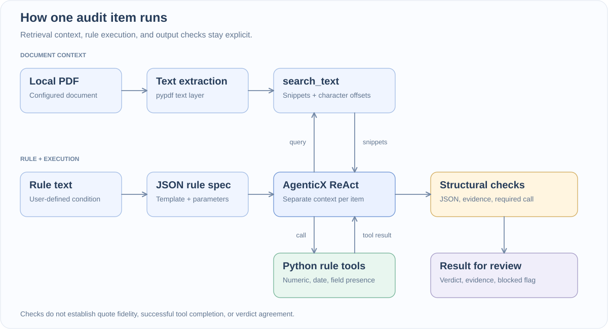
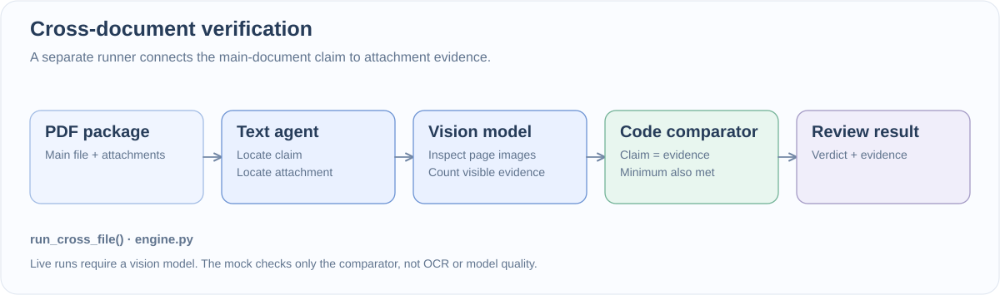

<div align="center">


# AgenticX Decision · Evidence-backed Document Review

**Document review with explicit tools, bounded context, and evidence you can inspect.**

[](https://www.python.org/downloads/)
[](https://github.com/DemonDamon/AgenticX)
[](LICENSE)
[](#try-it-locally)

**English** · [简体中文](README_CN.md)

[Quick start](#try-it-locally) · [How it works](#how-it-works) · [Live configuration](#connect-a-model)

</div>

If you hand an LLM a 50-page report and ask it to audit 20 compliance rules in one prompt—"board size must be between 3 and 15 and odd," "filed before June 30 of the following year," "conference count in the main report matches the photo attachments"—it fails in two very predictable ways: it misses clauses buried in the middle of the PDF, and it makes embarrassing mental-math or calendar mistakes even after finding the right sentence.

**AgenticX Decision** is a local research harness built on [AgenticX](https://github.com/DemonDamon/AgenticX) that splits those responsibilities cleanly:

- **Models locate and extract**: each audit item runs in its own isolated ReAct loop using `search_text` to pull short keyword snippets with `[位置≈offset]` character anchors instead of stuffing the full PDF into context.
- **Python tools calculate the verdict**: numeric ranges, odd/even parity, date deadlines, and cross-file count comparisons are executed by hand-written Python tools (`engine.py` literally instructs the agent: *"结论以此工具返回为准，禁止自行心算"* — adopt the tool's verdict, do not do mental arithmetic).
- **Humans inspect the evidence**: a local FastAPI web console streams every rule, retrieved snippet, tool call, and fail-closed block reason in one view.

You can run the [key-free synthetic demo](#try-it-locally) out of the box before connecting a live OpenAI-compatible provider.

## What is inside

| Capability | How it works in code |
| --- | --- |
| **Rule decomposition** | `decomposer.py` maps natural-language audit rules onto versioned JSON rule templates (`numeric_range`, `date_deadline`, `field_presence`, `semantic`)—never `exec()`ing LLM-generated code. |
| **Bounded retrieval** | `SearchTextTool` searches extracted PDF text and returns hit counts + windowed snippets with character offsets (`[位置≈86]`). |
| **Deterministic verdict tools** | `NumericRangeTool`, `DateDeadlineTool`, and `FieldPresenceTool` compute the pass/fail verdict in Python so the LLM never guesses arithmetic or calendar comparisons. |
| **Fail-closed output check** | Any run that returns malformed JSON, leaves `evidence` empty, or skips a required rule-tool call is automatically marked `blocked: true`. |
| **Cross-document verification (`E2`)** | `mztdemo_v2.py` extracts a claimed count from the main PDF, uses a vision model to inspect rendered attachment pages, and compares `claimed vs. evidenced` in Python. |
| **Local web console** | `app.py` (`127.0.0.1:8620`) provides rule editing, workspace selection, live SSE progress, evidence cards, and token-cost estimates. |

## How it works

Each audit item runs as an independent ReAct loop so rules don't pollute each other's context window:



<sub>[Mermaid source](docs/assets/audit-flow.mmd)</sub>

The structural gate blocks malformed JSON, empty `evidence`, or a skipped rule tool. Note what remains an open extension point for human review: the current validator checks that `search_text` and the rule tool were called and cited, but does not yet cryptographically verify that a quoted string wasn't paraphrased or that the agent's final summary didn't contradict the tool's return value.

### Cross-document path (`E2`)

When a claim in the main report ("held 5 member conferences") must be verified against attachment PDFs (sign-in sheets, photos, minutes), the runner executes a three-stage chain:



<sub>[Mermaid source](docs/assets/cross-file-flow.mmd)</sub>

## Try it locally

Requires **Python 3.10+ and Git**; the release was verified with Python 3.11. Installation fetches public dependencies, including a pinned [AgenticX source revision](https://github.com/DemonDamon/AgenticX/commit/a4d7caf29c9ce96f7b79ec2584b2f83f9ebdabe0).

```bash
git clone https://github.com/dubianche123/agenticx-document-review.git
cd agenticx-document-review

python3 -m venv .venv
source .venv/bin/activate
pip install -r requirements.txt

# Run the synthetic audit. No key, private files, or model requests.
python mztdemo.py --mock

# Start the local console.
python app.py --mock
```

Open **http://127.0.0.1:8620**. Keep the three preloaded synthetic rules, choose the offline demo workspace, and run the audit. If the port is occupied, use `python app.py --mock --port 9000`.

### What the demo shows

| Invented input | Example rule | Expected result |
| --- | --- | --- |
| Member count: 31 | Between 3 and 15, and odd | 不合格 — fails the range check |
| Report year: 2030; date: 2031-04-12 | Due by June 30 of the following year | 合格 — before the deadline |
| Approval pending; supporting basis missing | Unresolved approval requires review | 存疑 — needs follow-up |

Example result excerpt:

```json
{
  "item_id": "sample_number",
  "type": "rule:numeric_range",
  "agent_verdict": "不合格",
  "evidence": "[位置≈86] 成员人数：31",
  "blocked": false,
  "mock": true
}
```

Mock mode executes real AgenticX orchestration, search, and rule tools with **scripted model replies** from [sample_data.py](sample_data.py). It is a regression demonstration, not a model benchmark; it establishes no accuracy, latency, or cost claim. Offline rule decomposition returns a fixed example mapping, and newly saved custom rules are explicitly blocked in offline audit mode. Use live mode to evaluate your own rules.

## Connect a model

Use an OpenAI-compatible provider. Configure it through `python setup_key.py`, the console's settings dialog, or environment variables:

```bash
export MZT_LLM_KEY='<your-local-key>'
export MZT_LLM_BASE_URL='https://your-provider.example/v1'
export MZT_LLM_MODEL='<your-model-id>'
export MZT_PDF='/absolute/path/to/your/synthetic_report.pdf'

python mztdemo.py
# Or launch the console without --mock:
python app.py
```

The CLI audit uses the example rules; adapt them for your own evaluation. The console lets you define rules and choose PDFs under `data/`. For cross-document runs, point `MZT_MATERIAL_ROOT` at a local material package and configure the vision stage.

| Setting | Purpose |
| --- | --- |
| `MZT_LLM_KEY`, `MZT_LLM_BASE_URL`, `MZT_LLM_MODEL` | Global model configuration |
| `MZT_<STAGE>_KEY`, `MZT_<STAGE>_BASE_URL`, `MZT_<STAGE>_MODEL` | Override `DECOMPOSE`, `MAIN`, or `VISION`; unset fields inherit global settings |
| `MZT_DATA_DIR` | Local console workspaces and saved rules; defaults to `data/` |
| `MZT_PDF` | Input PDF for the bounded audit and full-text baseline |
| `MZT_MATERIAL_ROOT` | PDF package for the cross-document CLI |
| `MZT_CONFIG_DIR` | Optional directory for local settings; otherwise stored in the user home directory |

[.env.example](.env.example) is a reference and **is not automatically loaded**. Export variables explicitly. Keep keys out of endpoint URLs. Live runs send selected document content to the provider you configure.

## Experiments and checks

| Command | What it exercises |
| --- | --- |
| `python mztdemo.py --mock` | Search, numeric/date tools, and semantic replay through AgenticX |
| `python mztdemo_v2.py --mock` | Synthetic claim/evidence count comparison in Python |
| `python mztdemo_v3_baseline.py --mock` | Scripted full-text baseline responses |
| `python -m unittest discover -s tests -v` | Offline execution, SSE selection, key redaction, settings isolation, and path containment |
| `python cost.py calc --in 1000 --out 200 --preset example` | Token-cost arithmetic with invented unit prices |

Remove `--mock` for live experiments after configuring inputs and models. Do not compare mock outputs with live measurements. The included cost preset is **not a provider quote**; use your own current rates for real calculations. See the [experiment protocol](docs/EXPERIMENT_PROTOCOL.md) for a controlled comparison.

## Explore the code

```text
.
├── app.py                       Local FastAPI console
├── engine.py                    Retrieval, rule tools, ReAct runners, validation, SSE
├── decomposer.py                Natural-language rule → JSON specification
├── sample_data.py               Invented text, rules, and scripted responses
├── mzt_common.py                Local configuration and PDF helpers
├── mztdemo.py                    E1 · bounded audit
├── mztdemo_v2.py                 E2 · cross-document audit
├── mztdemo_v3_baseline.py        E3 · full-text baseline
├── cost.py                      Token-cost arithmetic
├── setup_key.py                 Local provider configuration
├── static/                      Console interface
├── tests/                       Synthetic offline/privacy regressions
└── docs/                        Protocol, release notes, and diagram assets
```

To add a deterministic check, implement a hand-written tool in [engine.py](engine.py), register its template, and extend the specification catalog in [decomposer.py](decomposer.py). Add synthetic cases for the expected verdict and failure paths. Keep rule specifications as data.

## Boundaries and data handling

- The console binds to `127.0.0.1` and has no authentication. Keep it local.
- Put private inputs in `data/`, outputs in `results/`, and credentials in environment variables or restricted local settings. These locations are ignored by Git.
- Source-text offsets support inspection; they are not page coordinates or proof that an LLM quote is faithful.
- Live semantic and vision outputs need evaluation on your own inputs. The structural validator does not establish legal or business correctness.
- Contributions and shareable artifacts must use invented data. Do not commit private PDFs, extracted text, model responses, keys, or logs.

Read the [security policy](SECURITY.md) and [release review](docs/PUBLIC_RELEASE_REVIEW.md) for the current scope.

## License and contributions

The project source is [Apache-2.0](LICENSE). Dependencies retain their own licenses; the [release review](docs/PUBLIC_RELEASE_REVIEW.md#direct-dependency-license-inventory) includes the direct dependency inventory.

Issues and contributions are welcome for new rule templates, input adapters, and stronger validation. Include a reproducible synthetic example and relevant offline checks.
