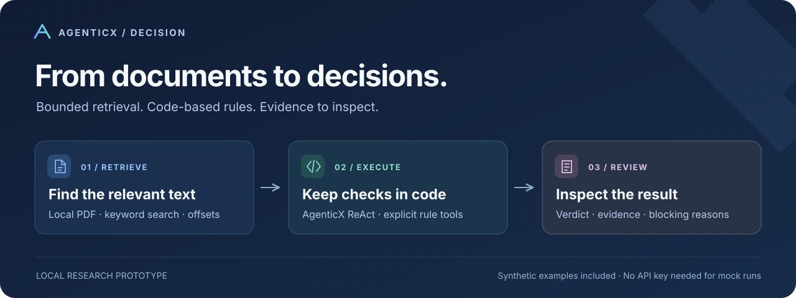
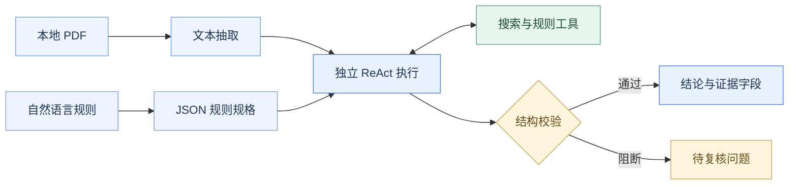
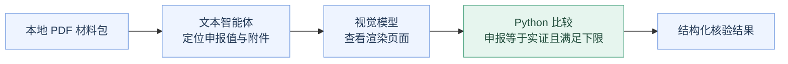

<div align="center">



# AgenticX Decision

**让文档审核有明确的工具调用、有界的上下文，以及可供复核的证据。**

[](https://www.python.org/downloads/)
[](https://github.com/DemonDamon/AgenticX)
[](LICENSE)
[](#快速体验)

[快速体验](#快速体验) · [工作原理](#工作原理) · [接入真实模型](#接入真实模型) · [English](README.md)

</div>

AgenticX Decision 是一个基于 AgenticX 的本地文档决策审计原型。智能体检索文档、调用手写规则工具，再输出供人复核的结构化结果。配套 Web 控制台把规则、证据、阻断原因和用量放在同一个流程里展示。

项目尝试一种具体分工：**模型负责定位和理解，Python 工具计算明确的规则条件，审核者复核证据与结论。** 仓库提供这条链路的可运行示例，并明确当前校验器能检查什么、还缺什么。

## 可以体验什么

| 能力 | 当前实现 |
| --- | --- |
| 规则结构化 | 将自然语言规则映射为 JSON 模板规格，不生成可执行代码 |
| 有界检索 | 抽取本地 PDF 文本，按关键词返回片段及字符位置 |
| 确定性工具 | 数值范围与奇偶、日期截止日、必填字段检查 |
| 语义审核 | 每个审核项独立运行 AgenticX ReAct，使用检索上下文 |
| 跨文件核验 | 定位主文件申报值与附件，视觉模型查看页面，Python 比较次数 |
| 本地控制台 | 编辑规则、选择 PDF 或材料包、流式查看结论、证据及用量 |
| 实验入口 | 有界审核、跨文件核验、全文直判基线及成本算术工具 |

**项目定位：研究原型。** 公开示例全部人工构造，不包含客户材料、内部实验测量、凭据或生产端点配置。

## 工作原理

每条审核项独立运行 ReAct。数值、日期等明确条件由小型代码工具执行，避免仅依赖模型在自然语言里计算。



结构校验会阻断非法 JSON、空证据字段或缺少必要规则工具调用的输出。**目前尚未验证引文是否真实对应原文、工具是否成功执行，以及模型最终结论是否与工具结果一致。** 这些仍需人工复核，也是后续可扩展的方向。

### 跨文件核验

当主文件的申报内容需要附件佐证时，走单独的核验路径：



在线运行需要本地 PDF 材料和具备视觉能力的模型。跨文件 `--mock` 示例只验证代码比较器，不执行 OCR，也不评测视觉模型。

## 快速体验

需要 **Python 3.10+ 和 Git**；当前发布内容已在 Python 3.11 环境验证。安装依赖需要联网，仅使用公开包与固定的[上游 AgenticX 源码版本](https://github.com/DemonDamon/AgenticX/commit/a4d7caf29c9ce96f7b79ec2584b2f83f9ebdabe0)。

```bash
git clone https://github.com/dubianche123/agenticX-decision-public.git
cd agenticX-decision-public

python3 -m venv .venv
source .venv/bin/activate
pip install -r requirements.txt

# 执行合成数据审核，无需密钥、私有文件或模型请求。
python mztdemo.py --mock

# 启动本地控制台。
python app.py --mock
```

打开 **http://127.0.0.1:8620**。保留预置的三条合成规则，选择离线演示工作区，再执行审核，即可看到结论与证据。如果端口被占用，可运行 `python app.py --mock --port 9000`。

### 演示里能看到什么

| 虚构输入 | 示例规则 | 预期结果 |
| --- | --- | --- |
| 成员人数为 31 | 3～15 人且为奇数 | 不合格：超过人数上限 |
| 报告年度 2030；日期 2031-04-12 | 次年 6 月 30 日前报送 | 合格：早于截止日期 |
| 审批待复核，未提供依据 | 审批未决且缺少依据时转复核 | 存疑：需要补充依据 |

结果节选：

```json
{
  "item_id": "sample_number",
  "type": "rule:numeric_range",
  "agent_verdict": "不合格",
  "evidence": "[位置≈86] 成员人数：31",
  "blocked": false,
  "mock": true
}
```

离线模式真实执行 AgenticX 编排、搜索和规则工具，**模型回答使用固定剧本**，来源见 [sample_data.py](sample_data.py)。它用于验证流程，不代表模型准确率、处理耗时或 Token 成本。离线规则拆解返回固定示例映射；保存后的自定义规则在离线审核中会被明确阻断，需要接入真实模型后评估。

## 接入真实模型

支持 OpenAI 兼容服务。可运行 `python setup_key.py`、使用控制台设置弹窗，或显式导出环境变量：

```bash
export MZT_LLM_KEY='<your-local-key>'
export MZT_LLM_BASE_URL='https://your-provider.example/v1'
export MZT_LLM_MODEL='<your-model-id>'
export MZT_PDF='/absolute/path/to/your/synthetic_report.pdf'

python mztdemo.py
# 控制台运行时不加 --mock：
python app.py
```

CLI 审核沿用示例规则，实际评估前需按任务修改。控制台可自定义规则，并选择 `data/` 下的 PDF。跨文件运行需要通过 `MZT_MATERIAL_ROOT` 指定材料包，并配置视觉阶段。

| 配置 | 用途 |
| --- | --- |
| `MZT_LLM_KEY`、`MZT_LLM_BASE_URL`、`MZT_LLM_MODEL` | 全局模型配置 |
| `MZT_<STAGE>_KEY`、`MZT_<STAGE>_BASE_URL`、`MZT_<STAGE>_MODEL` | 按 `DECOMPOSE`、`MAIN`、`VISION` 覆盖配置，未指定的字段继承全局设置 |
| `MZT_DATA_DIR` | 控制台工作区及保存规则的位置，默认 `data/` |
| `MZT_PDF` | 有界审核与全文基线的输入 PDF |
| `MZT_MATERIAL_ROOT` | 跨文件 CLI 的 PDF 材料包 |
| `MZT_CONFIG_DIR` | 可选本地配置目录，默认使用用户主目录 |

[.env.example](.env.example) 仅供参考，**不会自动加载**，需要显式 `export`。端点 URL 不应内嵌凭据。在线运行会将选中的文档内容发送至你配置的模型服务。

## 实验与验证

| 命令 | 验证内容 |
| --- | --- |
| `python mztdemo.py --mock` | AgenticX 搜索、数值/日期工具与语义审核剧本 |
| `python mztdemo_v2.py --mock` | 合成申报次数与附件实证次数的代码比较 |
| `python mztdemo_v3_baseline.py --mock` | 全文基线的固定模型回答 |
| `python -m unittest discover -s tests -v` | 离线执行、SSE 规则选择、密钥脱敏、配置隔离及路径边界 |
| `python cost.py calc --in 1000 --out 200 --preset example` | 基于虚构单价的 Token 成本算术 |

配置输入与模型后，可移除 `--mock` 执行在线实验。不要将离线剧本输出当作在线测量。内置单价**不是供应商报价**，真实测算必须使用自己的当前单价。受控对比方法见[实验协议](docs/EXPERIMENT_PROTOCOL.md)。

## 代码导航

```text
.
├── app.py                       本地 FastAPI 控制台
├── engine.py                    检索、规则工具、ReAct、校验与 SSE
├── decomposer.py                自然语言规则 → JSON 规格
├── sample_data.py               人工构造的文本、规则及模型回答
├── mzt_common.py                本地配置与 PDF 辅助函数
├── mztdemo.py                    E1 · 有界审核
├── mztdemo_v2.py                 E2 · 跨文件核验
├── mztdemo_v3_baseline.py        E3 · 全文直判基线
├── cost.py                      Token 成本算术
├── setup_key.py                 本地模型接入配置
├── static/                      控制台界面
├── tests/                       合成数据离线与隐私回归检查
└── docs/                        实验协议、发布记录及介绍图
```

扩展确定性规则时，在 [engine.py](engine.py) 中实现手写工具并注册模板，再扩充 [decomposer.py](decomposer.py) 的规则规格目录。为预期结论和失败路径补充合成用例，规则规格本身保持为数据。

## 使用边界与数据处理

- 控制台仅监听 `127.0.0.1`，没有认证，保持本地使用。
- 私有输入放在 `data/`，输出放在 `results/`；凭据使用环境变量或受限权限的本地配置。这些位置均由 Git 忽略。
- 字符位置便于定位片段，不等于 PDF 页内坐标，也不证明模型引用忠实于原文。
- 在线语义与视觉输出需要针对实际输入评测；结构校验无法保证业务或法律结论正确。
- 贡献和可分享产物必须使用人工构造的数据。不要提交私有 PDF、抽取文本、模型响应、密钥或日志。

更多范围说明见[安全策略](SECURITY.md)及[发布检查记录](docs/PUBLIC_RELEASE_REVIEW.md)。

## 许可证与贡献

项目源码采用 [Apache-2.0](LICENSE)。依赖保留各自许可证，[发布检查记录](docs/PUBLIC_RELEASE_REVIEW.md#direct-dependency-license-inventory)列出了直接依赖。

欢迎围绕规则模板、输入适配器和更严格的校验提出 Issue 或贡献实现，请附可复现的合成示例及相关离线验证。
